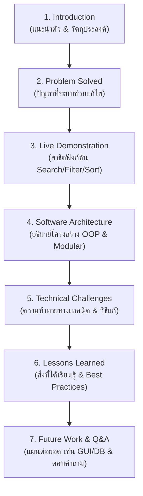

# 📋 Week 12: Final Project – Enhanced Task Manager CLI & Presentation
> **หลักสูตร Object-Oriented Programming (OOP) สำหรับนักศึกษาชั้นปีที่ 2**  
> เอกสารแนะนำการทำโครงงานปลายภาค, การพัฒนาโปรแกรมเชิงวัตถุ, การทดสอบระบบ และแนวทางการนำเสนอ

---

## 📌 สารบัญ (Table of Contents)
1. [วัตถุประสงค์การเรียนรู้ (Learning Outcomes)](#-วัตถุประสงค์การเรียนรู้-learning-outcomes)
2. [ภาพรวมของโปรเจกต์ (Project Overview)](#-ภาพรวมของโปรเจกต์-project-overview)
3. [โครงสร้าง Repository (Project Architecture)](#-โครงสร้าง-repository-project-architecture)
4. [คู่มือการทำ Lab ทีละขั้นตอน (Step-by-Step Implementation Guide)](#-คู่มือการทำ-lab-ทีละขั้นตอน-step-by-step-implementation-guide)
5. [วิธีการติดตั้งและรันระบบ (How to Run & Test)](#-วิธีการติดตั้งและรันระบบ-how-to-run--test)
6. [ตัวอย่าง Use Cases สำหรับการทดสอบ (Demo Scenarios)](#-ตัวอย่าง-use-cases-สำหรับการทดสอบ-demo-scenarios)
7. [สิ่งที่ต้องทำและส่ง (Deliverables & Submission Checklist)](#-สิ่งที่ต้องทำและส่ง-deliverables--submission-checklist)
8. [คู่มือการเตรียมตัวนำเสนอผลงาน (Final Presentation Guide)](#-คู่มือการเตรียมตัวนำเสนอผลงาน-final-presentation-guide)
9. [เกณฑ์การให้คะแนนและการประเมินผล (Assessment Rubric)](#-เกณฑ์การให้คะแนนและการประเมินผล-assessment-rubric)

---

## 🎯 วัตถุประสงค์การเรียนรู้ (Learning Outcomes)

ในการทำ Lab สัปดาห์ที่ 12 นี้ นักศึกษาจะได้ประยุกต์ใช้ความรู้ทั้งหมดที่ได้เรียนมาตลอดภาคการศึกษา:
* **Advanced OOP & Modularity**: การใช้ Class Inheritance, Method Overriding, Polymorphism และ Encapsulation ในโปรเจกต์หลายโมดูล (Multi-module)
* **Complex Data Manipulation**: การสร้างฟังก์ชันค้นหา (Search), การกรองหลายมิติพร้อมกัน (Multi-criteria Filter) และการจัดเรียงเชิงพหุสัณฐาน (Polymorphic Sort)
* **Data Persistence**: การอ่านและเขียนข้อมูล JSON โดยแปลงกลับเป็น Object ตามชนิดเดิมอย่างถูกต้อง
* **Testing & Debugging**: การเขียนและรันชุดทดสอบอัตโนมัติ (Automated Unit Tests) และการดักจับข้อผิดพลาด (Exception Handling)
* **Software Delivery & Presentation**: การเตรียม Source Code บน GitHub และการนำเสนอผลงานอย่างมืออาชีพ

---

## 💡 ภาพรวมของโปรเจกต์ (Project Overview)

**Enhanced Task Manager** คือโปรแกรมบริหารจัดการรายการงาน (Task Management) ผ่านหน้าต่าง Command-Line Interface (CLI) ที่รองรับงานหลากหลายประเภท:
1. **Normal Task**: งานทั่วไป มี ID, รายละเอียด, สถานะสำเร็จ/รอดำเนินการ และแท็ก (Tags)
2. **DueDateTask**: งานที่มีกำหนดเวลาส่ง (`due_date`) รองรับการตรวจสอบรูปแบบวันที่ (`YYYY-MM-DD`)
3. **PriorityTask**: งานที่มีระดับความสำคัญ (`High`, `Medium`, `Low`)
4. **ระบบ Tags**: ติดป้ายกำกับหลายป้ายต่องานหนึ่งชิ้น เพื่อใช้จัดหมวดหมู่และค้นหา
5. **ฟีเจอร์ขั้นสูง**:
   - 🔍 **Search**: ค้นหาข้อความบางส่วน (Partial match) ทั้งในรายละเอียดและ Tags แบบไม่สนตัวพิมพ์เล็ก-ใหญ่ (Case-insensitive)
   - 🎯 **Filter**: กรองข้อมูลแบบรวมหลายเงื่อนไข (สถานะ AND ช่วงเวลาส่ง AND ลำดับความสำคัญ AND แท็ก)
   - 🔃 **Sort**: เรียงลำดับตาม ID, Description, Completed Status, Due Date (จัดกลุ่มงานที่ไม่มีวันส่งไว้ท้ายสุด) และ Priority (เรียง High -> Medium -> Low)

---

## 🗂️ โครงสร้าง Repository (Project Architecture)

โค้ดถูกออกแบบตามหลัก **Separation of Concerns (SoC)** โดยแยกส่วน Data Model, Persistence, Business Logic และ UI ออกจากกันอย่างชัดเจน:

```text
Week12_ Final Project Development/
│
├── src/                            # โฟลเดอร์เก็บ Source Code ทั้งหมด
│   ├── __init__.py                 # กำหนดให้ src เป็น Python package
│   ├── task.py                     # Data Models: Task, DueDateTask, PriorityTask
│   ├── data_persistence.py         # Data Layer: จัดการอ่าน/เขียนไฟล์ JSON
│   ├── task_manager.py             # Business Logic Layer: จัดการ CRUD, Search, Filter, Sort
│   └── cli_interface.py            # Presentation Layer: เมนู CLI, รับและตรวจสอบ Input, แสดงผล
│
├── data/
│   └── tasks.json                  # ไฟล์เก็บข้อมูล JSON (เซฟและโหลดอัตโนมัติ)
│
├── tests/
│   ├── __init__.py
│   └── test_task_manager.py        # ชุดทดสอบ Unit Test อัตโนมัติ (ครอบคลุมทุกฟังก์ชัน)
│
├── main.py                         # จุดเริ่มต้นของโปรแกรม (Application Entry Point)
├── .gitignore                      # กรองไฟล์ที่ไม่ต้องการ commit ขึ้น GitHub
├── README.md                       # คู่มือการใช้งานและเอกสารประกอบ Lab ฉบับนี้
├── PLAN.md                         # เอกสารสรุปการออกแบบ สถาปัตยกรรม และการสะท้อนผลการพัฒนา
└── SUBMISSION_CHECKLIST.md         # เช็กลิสต์รายการส่งงานสำหรับนักศึกษา
```

### หน้าที่ของแต่ละโมดูล (Module Responsibilities)
| โมดูล | หน้าที่หลัก | หลักการทาง OOP ที่เกี่ยวข้อง |
| :--- | :--- | :--- |
| `task.py` | ประกาศคลาส `Task` และ Subclasses (`DueDateTask`, `PriorityTask`) | Inheritance, Method Overriding, Encapsulation |
| `data_persistence.py` | ควบคุมการอ่านและเขียนไฟล์ `data/tasks.json` จัดการ Serialization | Separation of Concerns, Error Handling |
| `task_manager.py` | ควบคุม Business Logic ทั้งหมด (CRUD, Search, Filter, Sort) | Polymorphism, Data Manipulation, Abstraction |
| `cli_interface.py` | ติดต่อกับผู้ใช้ผ่าน Terminal แสดงเมนูและรับค่า | Single Responsibility, Input Validation |
| `main.py` | เริ่มต้นสร้าง Object และรัน Loop การทำงาน | Dependency Injection / Orchestration |

---

## 🛠️ คู่มือการทำ Lab ทีละขั้นตอน (Step-by-Step Implementation Guide)

### Phase 1: การพัฒนาระบบ Tags ใน `src/task.py`
1. ใน Base Class `Task`:
   - เพิ่มพารามิเตอร์ `tags=None` ใน `__init__` และแปลงเป็น `list(tags) if tags is not None else []`
   - เพิ่ม Method `add_tag(tag)`: ลบช่องว่างและแปลงเป็นตัวพิมพ์เล็ก (`tag.strip().lower()`) ป้องกันแท็กซ้ำ
   - เพิ่ม Method `remove_tag(tag)`: ลบแท็กออกจากรายการ
   - ปรับปรุง `to_dict()`: ให้แนบ Key `"tags"` และ `"_type": "Task"`
   - ปรับปรุง `__str__()`: แสดงผลรูปแบบ `ID: {id} | Description: {desc} | Status: {status} | Tags: tag1, tag2`
2. ใน Subclasses `DueDateTask` และ `PriorityTask`:
   - ปรับ `__init__` ให้ส่ง `tags` ผ่าน `super().__init__(..., tags=tags)`
   - Override `to_dict()` ให้บันทึกฟิลด์เฉพาะ (`due_date` หรือ `priority`) ควบคู่กับ `_type`
   - Override `__str__()` ให้แทรกข้อมูลวันส่งหรือความสำคัญไว้ก่อนแท็ก

### Phase 2: การปรับปรุง Data Persistence ใน `src/data_persistence.py`
1. ตรวจสอบพาธไฟล์โดยอ้างอิงตำแหน่งโฟลเดอร์แบบ Dynamic (`os.path.join(os.path.dirname(__file__), '..', self.data_file)`)
2. ใน `load_tasks()`:
   - ตรวจสอบว่ามีโฟลเดอร์และไฟล์หรือไม่ หากไม่มีให้คืนค่า `[]`
   - ใช้ `json.load(f)` อ่านข้อมูลดิบ
   - อ่านค่า `_type` เพื่อสร้าง Object ตามคลาสจริง (`Task`, `DueDateTask`, `PriorityTask`)
   - ใส่ `t_dict.setdefault('tags', [])` เพื่อรองรับข้อมูลเวอร์ชันเก่าที่ยังไม่มี tags
   - มีการดักจับข้อผิดพลาด `json.JSONDecodeError`, `FileNotFoundError`, `Exception`
3. ใน `save_tasks()`:
   - แปลงทุกลาสในลิสต์ผ่าน `task.to_dict()` (Polymorphic call)
   - เขียนลงไฟล์ด้วย `json.dump(..., indent=4, ensure_ascii=False)`

### Phase 3: การสร้าง Business Logic ใน `src/task_manager.py`
1. **Search Logic (`search_tasks`)**:
   - รับพารามิเตอร์ `keyword` แปลงเป็นพิมพ์เล็ก (`lower()`)
   - ค้นหาแบบ Partial match ใน `task.description`
   - ค้นหาในรายการ `task.tags` โดยใช้ `any(keyword_lower in tag.lower() for tag in task.tags)`
2. **Filter Logic (`filter_tasks`)**:
   - รองรับพารามิเตอร์: `status`, `due_date_before`, `due_date_after`, `priority_level`, `contains_tags`
   - กรองแบบต่อเนื่อง (Chaining / Sequential filtering)
   - กรองวันส่งโดยตรวจสอบ `isinstance(t, DueDateTask)` ก่อนเปรียบเทียบ `datetime.date`
   - กรองความสำคัญโดยตรวจสอบ `isinstance(t, PriorityTask)`
   - กรอง Tags โดยเช็กว่า task ต้องมีแท็กครบทุกตัวที่ระบุ (`all(...)`)
3. **Sort Logic (`sort_tasks`)**:
   - สร้าง Priority Mapping: `{"High": 1, "Medium": 2, "Low": 3}`
   - กรณีเรียงตาม `due_date`: ให้ใช้ Key `(t.due_date if isinstance(t, DueDateTask) else datetime.date.max, t.id)` เพื่อดันงานที่ไม่มีวันกำหนดส่งไปไว้ล่างสุด
   - กรณีเรียงตาม `priority`: ให้ใช้ Key `(self.PRIORITY_MAP.get(t.priority, 99) if isinstance(t, PriorityTask) else 99, t.id)`
   - รองรับทิศทาง `reverse=True` (จากมากไปน้อย) และ `reverse=False` (จากน้อยไปมาก)

### Phase 4: หน้าต่างรับคำสั่ง CLI ใน `src/cli_interface.py`
1. แสดงเมนูตัวเลือก 1 ถึง 9 และ 0 เพื่อออกจากโปรแกรม
2. สร้างฟังก์ชันรับค่าพร้อม Validation:
   - `get_due_date_input()`: ตรวจสอบรูปแบบด้วย `datetime.datetime.strptime(..., '%Y-%m-%d')`
   - `get_priority_input()`: ตรวจสอบให้อยู่ใน `['High', 'Medium', 'Low']`
   - `get_tags_input()`: แยกข้อความด้วย comma (`,`) และ normalize ตัวอักษร
3. นำเสนอรายการงานด้วยฟังก์ชัน `_display_tasks()` ที่อ่านง่ายและบอกจำนวนผลลัพธ์ทั้งหมด

### Phase 5: การทดสอบ Unit Test อัตโนมัติใน `tests/test_task_manager.py`
1. ทดสอบการทำงานของแต่ละ Class Method ใน `TestTaskModels`
2. ทดสอบ Business Logic การ CRUD, Search, Multi-criteria Filter, Sort ใน `TestTaskManagerLogic`
3. ทดสอบการเขียนและอ่านไฟล์ JSON ซ้ำว่าข้อมูลไม่สูญหายและคืนสภาพเป็น Object เดิมได้ 100%

---

## 💻 วิธีการติดตั้งและรันระบบ (How to Run & Test)

### 1. โคลน Repository และเข้าสู่ไดเรกทอรี
```bash
git clone https://github.com/tankeiei/Week12_Final_Project_Development.git
cd Week12_Final_Project_Development
```

### 2. ตรวจสอบเวอร์ชัน Python
แนะนำให้ใช้ **Python 3.10+** (โปรเจกต์นี้ใช้ Standard Libraries ทั้งหมด จึงไม่ต้องติดตั้ง pip เพิ่มเติม):
```bash
python --version
```

### 3. รันโปรแกรมหลัก
```bash
python main.py
```

### 4. รันชุดทดสอบอัตโนมัติ (Automated Unit Tests)
ก่อนส่งงาน นักศึกษาต้องรันชุดทดสอบเพื่อยืนยันความถูกต้องของ Logic ทั้งหมด:
```bash
python -m unittest discover tests
```
*ผลลัพธ์ที่ถูกต้องควรแสดง:*
```text
........
----------------------------------------------------------------------
Ran 8 tests in 0.025s

OK
```

---

## 🧪 ตัวอย่าง Use Cases สำหรับการทดสอบ (Demo Scenarios)

ในการนำเสนอหรือทดสอบ ให้นักศึกษาทำตาม Scenario ต่อไปนี้เพื่อแสดงฟังก์ชันที่พัฒนา:

### Scenario 1: การเพิ่มงานพร้อมระบุ Tags
* เลือกเมนู `2` (Add Due Date Task)
* Description: `Final Project Submission`
* Due date: `2026-10-15`
* Tags: `study, urgent, final`
* ตรวจสอบว่าระบบบันทึกและแสดงผลแท็กได้อย่างถูกต้อง

### Scenario 2: การค้นหา (Search)
* เลือกเมนู `7` (Search Tasks)
* กรอก Keyword: `urgent`
* ผลลัพธ์: จะต้องแสดงงานทั้งหมดที่มีคำว่า `urgent` ในชื่อรายละเอียด **หรือ** อยู่ใน Tags

### Scenario 3: การกรองข้อมูลขั้นสูง (Filter)
* เลือกเมนู `8` (Filter Tasks)
* Completed status: กด `Enter` (ข้าม)
* Due date before: `2026-10-01`
* Due date after: กด `Enter` (ข้าม)
* Priority: กด `Enter` (ข้าม)
* Tags: `study`
* ผลลัพธ์: แสดงเฉพาะงานที่ต้องส่งก่อนวันที่ 1 ต.ค. 2026 และมีแท็ก `study`

### Scenario 4: การจัดเรียงตามลำดับความสำคัญ (Sort by Priority)
* เลือกเมนู `9` (Sort Tasks)
* Sort by: `priority`
* Reverse order: `no`
* ผลลัพธ์: งานที่มี Priority `High` จะขึ้นมาอยู่อันดับแรก ตามด้วย `Medium`, `Low` และงานทั่วไปที่ไม่มี Priority จะอยู่ท้ายสุด

---

## 📦 สิ่งที่ต้องทำและส่ง (Deliverables & Submission Checklist)

นักศึกษาทุกคน/ทุกกลุ่ม จะต้องส่งชิ้นงานให้ครบถ้วนทั้ง 6 รายการดังต่อไปนี้:

| ลำดับ | รายการสิ่งที่ต้องส่ง | รายละเอียดที่ต้องตรวจสอบ |
| :---: | :--- | :--- |
| **1** | **ลิงก์ GitHub Repository** | <ul><li>Repository ต้องเป็น Public หรือตั้งค่าสิทธิ์ให้อาจารย์/TA เข้าถึงได้</li><li>มี Commit History สม่ำเสมอ แสดงกระบวนการพัฒนาทีละฟีเจอร์อย่างต่อเนื่อง</li></ul> |
| **2** | **ซอร์สโค้ดฉบับสมบูรณ์** | <ul><li>ไฟล์ใน `src/` (`task.py`, `data_persistence.py`, `task_manager.py`, `cli_interface.py`) และ `main.py`</li><li>โค้ดเขียนถูกต้องตามมาตรฐาน PEP 8 และมี Docstrings อธิบายคลาส/ฟังก์ชัน</li></ul> |
| **3** | **ไฟล์ข้อมูลตัวอย่าง (`data/tasks.json`)** | <ul><li>มีข้อมูลงานเตรียมไว้ล่วงหน้าอย่างน้อย 5-6 รายการ ครบทุกประเภท (`Task`, `DueDateTask`, `PriorityTask`)</li><li>มี Tags หลากหลาย เพื่อพร้อมสำหรับการ Live Demo ทันที</li></ul> |
| **4** | **เอกสารสรุปโครงการ (`README.md`)** | <ul><li>ระบุชื่อ-นามสกุล, รหัสนักศึกษา, กลุ่มเรียน</li><li>อธิบายฟีเจอร์ที่พัฒนาสำเร็จ และวิธีใช้งานโปรแกรม</li></ul> |
| **5** | **เอกสารการออกแบบและสะท้อนผล (`PLAN.md`)** | <ul><li>บันทึกการออกแบบระบบตามสถาปัตยกรรม OOP</li><li>ระบุปัญหาทางเทคนิคที่พบ (Technical Challenges), วิธีแก้ไข (Solutions) และแนวทางการต่อยอด (Future Work)</li></ul> |
| **6** | **สไลด์การนำเสนอ / วิดีโอคลิป (Presentation Deliverable)** | <ul><li>สไลด์การนำเสนอที่มีเนื้อหาครบทั้ง 7 ส่วนตามข้อกำหนด</li><li>ไฟล์สไลด์ (.pdf หรือ .pptx) แนบในระบบส่งงานตามที่ผู้สอนกำหนด</li></ul> |

> 📌 *สามารถตรวจสอบรายการอย่างละเอียดได้ในไฟล์ [SUBMISSION_CHECKLIST.md](file:///c:/Users/tanku/Documents/งานโฟ/Week12_%20Final%20Project%20Development/SUBMISSION_CHECKLIST.md)*

---

## 🎤 คู่มือการเตรียมตัวนำเสนอผลงาน (Final Presentation Guide)

การนำเสนอผลงาน Final Project กำหนดเวลา **5-7 นาทีต่อกลุ่ม/บุคคล** โดยแบ่งเนื้อหาออกเป็น **7 ส่วนหลัก** ดังนี้:



### 1. Introduction (0.5 - 1 นาที)
* แนะนำชื่อ-นามสกุล, รหัสนักศึกษา, ชื่อโปรเจกต์
* กล่าวถึงจุดเริ่มต้นและวัตถุประสงค์ในการสร้าง Enhanced Task Manager CLI

### 2. Problem Solved (0.5 นาที)
* อธิบายว่าโปรแกรมนี้แก้ปัญหาการจัดการงานในชีวิตประจำวันของนักศึกษาอย่างไร (เช่น ป้องกันงานตกหล่น, แยกงานด่วน, จัดกลุ่มด้วย Tags)

### 3. Features & Live Demo (2 - 3 นาที) **[ส่วนสำคัญที่สุด]**
* สาธิตการทำงานจริงบน Terminal โดยใช้ข้อมูลที่เตรียมไว้ใน `data/tasks.json`:
  1. แสดงรายชื่องานทั้งหมด (List All)
  2. เพิ่มงานใหม่ที่มี Tags และ Due Date หรือ Priority
  3. ค้นหา (Search) ด้วย Keyword
  4. กรองงาน (Filter) ตามเงื่อนไขหลายมิติ
  5. เรียงลำดับงาน (Sort) ตาม Priority หรือ Due Date
  6. เปลี่ยนสถานะงานเป็นสำเร็จ (Complete) และลบงาน (Delete)
* **Tip**: ซ้อม Demo ให้คล่อง และเตรียมข้อมูล Backup ไว้เสมอ

### 4. Architectural Overview (1 นาที)
* อธิบายโครงสร้าง Class Diagram: Base Class `Task` -> `DueDateTask`, `PriorityTask`
* อธิบายการแยกโมดูล: ทำไมต้องแยก `data_persistence.py` ออกจาก `task_manager.py` (Separation of Concerns)

### 5. Technical Challenges & Solutions (1 นาที)
* เล่าปัญหาทางเทคนิคที่พบและวิธีการแก้ปัญหา เช่น:
  - **Polymorphic Sorting**: วิธีการเรียง Due Date หรือ Priority เมื่อมี Base Task ปะปนอยู่ (การใช้ Lambda ร่วมกับ `datetime.date.max` และ Priority Map)
  - **Multi-criteria Filtering**: การรวมเงื่อนไขหลายตัวแปรพร้อมกันโดยไม่ทำให้โปรแกรม Crash
  - **Schema Backward Compatibility**: การโหลดไฟล์ JSON ข้อมูลเดิมที่ไม่มีฟิลด์ `tags`

### 6. Lessons Learned (0.5 นาที)
* สิ่งที่ได้เรียนรู้จากการเขียนโปรแกรมขนาดใหญ่: ความสำคัญของการวางแผนใน `PLAN.md`, การเขียน Unit Tests, การ Debug ด้วย Breakpoints และ Logging

### 7. Future Work & Q&A (0.5 - 1 นาที)
* แนวคิดในการพัฒนาต่อยอด เช่น การสร้างหน้ากาก GUI (Tkinter/PyQt), การเชื่อมต่อฐานข้อมูล SQLite, หรือระบบแจ้งเตือนทาง LINE/Email
* ตอบคำถามอาจารย์และเพื่อนร่วมชั้น

---

## 📊 เกณฑ์การให้คะแนนและการประเมินผล (Assessment Rubric)

| หมวดการประเมิน | สัดส่วน | เกณฑ์การพิจารณา |
| :--- | :---: | :--- |
| **1. OOP & Code Architecture** | 25% | การสืบทอดคุณสมบัติ (Inheritance), Polymorphism, ความเป็นระเบียบของโมดูล, PEP 8, Docstrings |
| **2. Core & Enhanced Features** | 25% | CRUD ทำงานได้สมบูรณ์, ระบบ Tags, Search, Filter และ Sort ถูกต้องทุกกรณีทดสอบ |
| **3. Persistence & Error Handling** | 15% | การอ่าน/เขียน JSON สมบูรณ์, ไม่พังเมื่อเจอข้อมูลผิดพลาด, มี Validation ชัดเจน |
| **4. Testing & Code Quality** | 15% | มี Unit Tests ที่ครอบคลุม, รันผ่าน 100%, ไม่มี dead code |
| **5. Presentation & Live Demo** | 15% | นำเสนอครบ 7 ส่วน ตรงเวลา สาธิตฟังก์ชันได้คล่องแคล่ว ตอบคำถามเชิงเทคนิคได้ดี |
| **6. Git & Documentation** | 5% | Git Commit History สม่ำเสมอ, `README.md` และ `PLAN.md` ครบถ้วนชัดเจน |

---

## 👨‍💻 ข้อมูลผู้จัดทำ (Student Information)
* **ชื่อ-นามสกุล**: อเสข ปัญญาวงค์
* **รหัสนักศึกษา**: 663380247-9
* **กลุ่มเรียน / Section**: [ระบุกลุ่มเรียน]
* **วันส่งผลงาน**: [ระบุวันที่]
